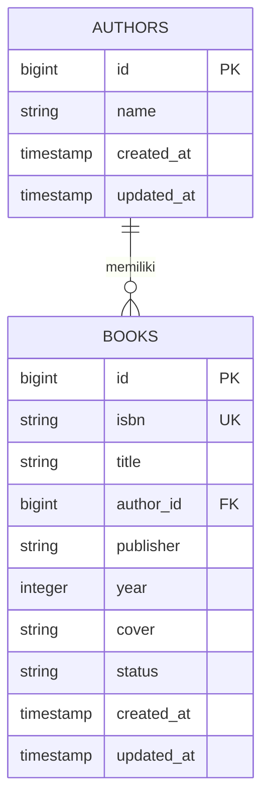

# 📚 AUTHBOOK — SISTEM PENGELOLAAN DATA BUKU
## TUGAS 3: ANALISIS DAN DOKUMENTASI
### PRAKTIKUM PEMROGRAMAN BERBASIS WEB — PERTEMUAN 8

**Identitas Mahasiswa**

| Keterangan | Informasi |
|---|---|
| Nama | Ridwan Odi Nugroho |
| NPM | 4524210089 |
| Program Studi | Teknik Informatika |
| Universitas | Universitas Pancasila |
| Mata Kuliah | Pemrograman Berbasis Web |
| Praktikum | Pertemuan 8 |

---

# 1. PENJELASAN ARSITEKTUR (7 POIN)

## 1.1 Diagram ERD (Entity Relationship Diagram)

Authbook merupakan aplikasi pengelolaan data buku berbasis Laravel dan Filament. Aplikasi ini menggunakan dua tabel utama, yaitu `authors` dan `books`.

Tabel `authors` digunakan untuk menyimpan informasi penulis, sedangkan tabel `books` digunakan untuk menyimpan informasi buku. Kedua tabel memiliki hubungan melalui kolom `author_id` yang berfungsi sebagai Foreign Key.

Berikut merupakan diagram ERD aplikasi Authbook:



**Keterangan:**

1. `authors` merupakan tabel yang menyimpan data penulis buku.
2. `books` merupakan tabel yang menyimpan data buku.
3. `id` pada tabel authors merupakan Primary Key.
4. `id` pada tabel books merupakan Primary Key.
5. `author_id` pada tabel books merupakan Foreign Key.
6. `isbn` digunakan sebagai identitas unik buku.
7. `created_at` dan `updated_at` digunakan untuk mencatat waktu pembuatan dan perubahan data.

## 1.2 Penjelasan Relasi Antar Tabel

Aplikasi Authbook menerapkan hubungan One-to-Many dan Many-to-One menggunakan Eloquent ORM pada Laravel.

### A. Relasi One-to-Many (Author ke Book)

Relasi One-to-Many menunjukkan bahwa satu penulis dapat memiliki banyak buku.

Relasi ini diterapkan pada model `Author` menggunakan method `hasMany()`.

Contoh kode:

```php
public function books(): HasMany
{
    return $this->hasMany(Book::class);
}
```

Penjelasan:

- Satu Author dapat memiliki beberapa Book.
- Data penulis dapat dihubungkan dengan seluruh buku yang ditulisnya.
- Relasi menggunakan kolom `author_id` pada tabel books.

### B. Relasi Many-to-One (Book ke Author)

Relasi Many-to-One menunjukkan bahwa beberapa buku dapat dimiliki oleh satu penulis.

Relasi ini diterapkan pada model `Book` menggunakan method `belongsTo()`.

Contoh kode:

```php
public function author(): BelongsTo
{
    return $this->belongsTo(Author::class);
}
```

Penjelasan:

- Setiap Book berhubungan dengan satu Author.
- Informasi penulis dapat diperoleh melalui data buku.
- Kolom `author_id` digunakan untuk menghubungkan kedua tabel.

### C. Penggunaan Foreign Key

Foreign Key merupakan atribut yang menghubungkan satu tabel dengan tabel lainnya.

Pada Authbook, kolom `author_id` pada tabel books mengacu pada kolom `id` pada tabel authors.

Dengan adanya Foreign Key, hubungan antara data buku dan penulis dapat dikelola secara terstruktur.

Selain itu, migration menggunakan pengaturan `onDelete('cascade')` sehingga penghapusan data penulis juga dirancang untuk menghapus data buku yang berhubungan dengannya.

## 1.3 Penjelasan Flow Aplikasi (Request hingga Response)

Aplikasi Authbook menggunakan Laravel sebagai framework utama dan Filament sebagai panel administrasi.

Proses kerja aplikasi dimulai ketika pengguna mengakses halaman administrasi melalui browser. Request kemudian diproses oleh Laravel hingga menghasilkan response yang ditampilkan kembali kepada pengguna.

Berikut tahapan prosesnya:

**1. User Request**

Pengguna membuka browser dan mengakses halaman aplikasi Authbook, misalnya halaman login administrasi pada `/admin/login`.

**2. Laravel Routing**

Request diterima oleh Laravel dan diproses melalui sistem routing untuk menentukan tujuan permintaan.

**3. Authentication**

Laravel memeriksa autentikasi pengguna sebelum memberikan akses ke halaman administrasi.

**4. Filament Resource**

Setelah pengguna berhasil masuk, Filament menangani permintaan melalui Resource yang berhubungan dengan model Author atau Book.

**5. Eloquent ORM**

Eloquent ORM menghubungkan model Laravel dengan database untuk melakukan operasi pengelolaan data.

**6. Database SQLite**

Database SQLite menyimpan data penulis dan buku. Operasi yang dapat dilakukan meliputi Create, Read, Update, dan Delete.

**7. Response**

Setelah proses selesai, Laravel mengembalikan hasil pemrosesan kepada browser untuk ditampilkan melalui antarmuka Filament.

### Diagram Flow Request hingga Response

```text
          USER
            |
            v
         BROWSER
            |
            v
      LARAVEL ROUTING
            |
            v
      AUTHENTICATION
            |
            v
     FILAMENT RESOURCE
            |
            v
       ELOQUENT ORM
            |
            v
       DATABASE SQLITE
            |
            v
     HASIL PEMROSESAN
            |
            v
         RESPONSE
            |
            v
       BROWSER USER
```

Berdasarkan alur tersebut, Laravel bertanggung jawab terhadap pemrosesan aplikasi, Eloquent ORM mengelola komunikasi dengan database, sedangkan Filament menyediakan antarmuka administrasi untuk mengelola data.

---

# 2. PERBANDINGAN DENGAN PENDEKATAN TRADISIONAL (7 POIN)

## 2.1 Perbandingan Membuat CRUD dengan Filament dan Manual

CRUD merupakan singkatan dari Create, Read, Update, dan Delete. CRUD merupakan operasi dasar yang digunakan untuk mengelola data dalam suatu aplikasi.

Pada aplikasi Authbook, Filament digunakan sebagai alat bantu untuk membuat panel administrasi yang mendukung pengelolaan data.

Terdapat dua pendekatan dalam pembuatan CRUD, yaitu menggunakan Filament dan menggunakan pendekatan manual dengan Laravel.

### A. Pendekatan Menggunakan Filament

Filament merupakan library berbasis Laravel yang digunakan untuk membangun panel administrasi.

Dengan menggunakan Filament, pengembang dapat membuat Resource yang terhubung dengan model untuk mengelola data.

Pada aplikasi Authbook, Resource dapat digunakan untuk mengelola data Author dan Book.

Beberapa kemampuan yang disediakan Filament meliputi:

1. Membuat data baru melalui form.
2. Menampilkan data dalam bentuk tabel.
3. Mengubah data yang telah tersimpan.
4. Menghapus data.
5. Melakukan pencarian data.
6. Menggunakan filter pada tabel.
7. Menampilkan detail data.

Penggunaan Filament dapat mengurangi penulisan kode berulang karena komponen administrasi telah disediakan oleh library.

### B. Pendekatan Manual Menggunakan Laravel

Pendekatan manual merupakan metode pembuatan CRUD dengan menulis kode program sendiri menggunakan fitur Laravel.

Pengembang perlu membuat beberapa komponen, seperti:

1. Model untuk berinteraksi dengan database.
2. Migration untuk membuat struktur tabel.
3. Controller untuk mengatur proses CRUD.
4. Route untuk menghubungkan URL dengan controller.
5. View Blade untuk menampilkan antarmuka.
6. Form untuk memasukkan dan mengubah data.
7. Validasi untuk memeriksa data yang dimasukkan.

Pendekatan manual memberikan kebebasan kepada pengembang dalam menentukan tampilan, proses, dan alur kerja aplikasi.

## 2.2 Kelebihan dan Kekurangan Masing-Masing

Berikut merupakan perbandingan penggunaan Filament dan pendekatan manual:

| Aspek | Filament | Manual Laravel |
|---|---|---|
| Kecepatan | Lebih cepat | Membutuhkan waktu lebih lama |
| Penulisan kode | Lebih sedikit | Lebih banyak |
| Tampilan | Komponen sudah tersedia | Dibuat sendiri |
| Kustomisasi | Mengikuti komponen Filament | Lebih fleksibel |
| CRUD | Lebih praktis | Dibangun sendiri |
| Pencarian | Komponen tersedia | Harus dibuat sendiri |
| Filter | Komponen tersedia | Harus dibuat sendiri |
| Pemeliharaan | Terstruktur melalui Resource | Bergantung pada struktur kode |
| Pembelajaran | Mempelajari konsep Resource | Memahami proses CRUD secara langsung |

### A. Kelebihan Filament

1. Mempercepat proses pembuatan aplikasi CRUD.
2. Menyediakan komponen form dan tabel.
3. Memiliki fitur pencarian dan filter.
4. Mengurangi penulisan kode berulang.
5. Mempermudah pembuatan panel administrasi.
6. Terintegrasi dengan model dan Eloquent ORM Laravel.

### B. Kekurangan Filament

1. Pengembang harus mempelajari struktur dan cara kerja Filament.
2. Beberapa kustomisasi membutuhkan pemahaman lebih lanjut.
3. Bergantung pada kompatibilitas library dengan versi Laravel.
4. Tidak selalu cocok untuk aplikasi yang memiliki alur antarmuka sangat khusus.

### C. Kelebihan Pendekatan Manual

1. Memberikan kebebasan dalam merancang tampilan aplikasi.
2. Mempermudah pengaturan alur kerja sesuai kebutuhan.
3. Membantu memahami proses CRUD secara mendalam.
4. Memberikan kontrol lebih besar terhadap kode program.
5. Tidak membutuhkan library panel administrasi tambahan.

### D. Kekurangan Pendekatan Manual

1. Membutuhkan waktu pengembangan lebih lama.
2. Penulisan kode lebih banyak.
3. Pengembang harus membuat tampilan dan validasi sendiri.
4. Pemeliharaan dapat menjadi lebih sulit apabila kode tidak terorganisasi.

## 2.3 Kapan Sebaiknya Menggunakan Filament dan Kapan Tidak?

### A. Filament Sebaiknya Digunakan Ketika:

1. Membuat aplikasi administrasi atau dashboard.
2. Membutuhkan pengelolaan data CRUD dengan cepat.
3. Membuat sistem pengelolaan buku, pengguna, produk, atau kategori.
4. Membutuhkan fitur tabel, pencarian, filter, dan form.
5. Mengembangkan aplikasi Laravel yang membutuhkan panel administrasi.

### B. Filament Tidak Harus Digunakan Ketika:

1. Aplikasi membutuhkan desain antarmuka yang sangat khusus.
2. Memerlukan alur interaksi yang tidak sesuai dengan komponen Filament.
3. Pengembangan lebih berfokus pada pembelajaran dasar proses CRUD.
4. Penggunaan library tambahan tidak sesuai dengan kebutuhan proyek.

### C. Kesimpulan Perbandingan

Berdasarkan perbandingan tersebut, Filament lebih sesuai digunakan untuk mempercepat pembuatan panel administrasi dan pengelolaan data.

Sementara itu, pendekatan manual lebih sesuai ketika pengembang membutuhkan kontrol penuh terhadap tampilan dan proses aplikasi.

Dalam proyek Authbook, penggunaan Filament merupakan pilihan yang tepat karena aplikasi berfokus pada pengelolaan data penulis dan buku melalui panel administrasi.

---

# 3. REFLEKSI PEMBELAJARAN (6 POIN)

## 3.1 Apa yang Dipelajari dari Praktikum Ini?

Melalui praktikum pengembangan Authbook, saya memperoleh pemahaman mengenai pembuatan aplikasi web menggunakan framework Laravel dan library Filament.

Beberapa hal yang saya pelajari antara lain:

1. Memahami proses pembuatan proyek Laravel menggunakan Composer.
2. Memahami konfigurasi database SQLite.
3. Mempelajari pembuatan Model dan Migration.
4. Memahami hubungan antar tabel menggunakan relasi One-to-Many dan Many-to-One.
5. Memahami penggunaan Primary Key dan Foreign Key.
6. Mempelajari penggunaan Eloquent ORM untuk berinteraksi dengan database.
7. Memahami penggunaan Filament sebagai panel administrasi.
8. Mempelajari pembuatan fitur CRUD.
9. Memahami penggunaan Factory dan Seeder untuk menyediakan data contoh.
10. Mempelajari penggunaan Git dan GitHub untuk menyimpan serta mengelola kode program.

Selain itu, saya juga memahami bahwa Laravel dan Filament dapat digunakan bersama untuk membangun aplikasi pengelolaan data yang lebih terstruktur dan efisien.

## 3.2 Kesulitan yang Dihadapi dan Cara Mengatasinya

Selama proses pengerjaan proyek Authbook, terdapat beberapa kendala yang saya hadapi.

### A. Kendala Instalasi Filament

Pada proses instalasi Filament, saya mengalami kendala terkait persyaratan versi dan security advisory dari Composer.

Hal tersebut membuat proses instalasi membutuhkan pemeriksaan tambahan terhadap versi Laravel, PHP, dan dependensi yang digunakan.

**Cara mengatasi:**

Memeriksa versi PHP dan Laravel, membaca pesan error Composer, serta menyesuaikan proses instalasi dengan kompatibilitas library yang digunakan.

### B. Kendala pada Policy

Saya mengalami kesalahan pada file `AuthorPolicy.php` karena deklarasi nama class tidak sesuai dengan nama file. Kesalahan tersebut menyebabkan konflik deklarasi class dengan `BookPolicy`.

**Cara mengatasi:**

Memeriksa kembali nama class pada masing-masing file Policy dan memastikan bahwa nama class sesuai dengan nama file serta tanggung jawab masing-masing.

### C. Kendala Pengelolaan Git dan GitHub

Saya juga mengalami beberapa kendala ketika mengunggah proyek ke GitHub, terutama terkait struktur folder, remote repository, dan proses push.

**Cara mengatasi:**

Memeriksa direktori proyek, memastikan remote repository sudah benar, serta menggunakan perintah Git secara bertahap untuk menghindari kesalahan ketika mengunggah file.

### D. Kendala Memahami Relasi Database

Pada awal pengerjaan, saya perlu memahami bagaimana hubungan antara tabel Author dan Book bekerja, khususnya penggunaan Foreign Key dan method relasi Eloquent.

**Cara mengatasi:**

Mempelajari kembali fungsi `hasMany()` dan `belongsTo()`, kemudian memeriksa hubungan data melalui Laravel Tinker.

Dari berbagai kendala tersebut, saya belajar bahwa proses pengembangan aplikasi tidak hanya membutuhkan kemampuan menulis kode, tetapi juga kemampuan membaca pesan kesalahan, melakukan konfigurasi, dan mencari solusi secara mandiri.

## 3.3 Rencana Pengembangan Aplikasi Selanjutnya

Untuk pengembangan aplikasi Authbook selanjutnya, terdapat beberapa fitur yang dapat ditambahkan agar aplikasi menjadi lebih lengkap.

### A. Pengelolaan Data yang Lebih Lengkap

Menambahkan informasi buku seperti kategori, deskripsi, dan tanggal penerbitan agar data buku lebih terperinci.

### B. Fitur Peminjaman Buku

Menambahkan fitur untuk mencatat proses peminjaman dan pengembalian buku sehingga status ketersediaan buku dapat dikelola dengan lebih baik.

### C. Pencarian dan Filter Lanjutan

Mengembangkan fitur pencarian berdasarkan judul, ISBN, nama penulis, dan status ketersediaan buku.

### D. Pengelolaan Hak Akses Pengguna

Menambahkan pembagian hak akses antara administrator dan pengguna biasa agar pengelolaan aplikasi lebih terkontrol.

### E. Laporan Data Buku

Menambahkan fitur laporan yang menampilkan jumlah buku, jumlah penulis, serta jumlah buku yang tersedia dan sedang dipinjam.

### F. Pengembangan Tampilan Aplikasi

Mengembangkan tampilan antarmuka agar lebih menarik, mudah digunakan, dan responsif pada berbagai ukuran perangkat.

Dengan adanya pengembangan tersebut, aplikasi Authbook diharapkan dapat menjadi sistem pengelolaan buku yang lebih lengkap dan dapat digunakan untuk kebutuhan administrasi perpustakaan.

---

# 4. DOKUMENTASI HASIL PRAKTIKUM

Untuk melengkapi laporan, berikut dokumentasi yang dapat dilampirkan sebagai bukti pengerjaan.

| No. | Dokumentasi | Keterangan |
|---|---|---|
| 1 | Diagram ERD | Hubungan tabel Authors dan Books |
| 2 | Struktur Database | Bukti tabel authors dan books |
| 3 | Admin Panel | Halaman login dan dashboard Filament |
| 4 | Data Authors | Daftar penulis yang tersimpan |
| 5 | Data Books | Daftar buku yang tersimpan |
| 6 | Form CRUD | Form tambah dan edit buku |
| 7 | Search Results | Bukti pencarian data buku |
| 8 | Active Filter | Bukti penggunaan filter data |

**Catatan:** Screenshot harus berasal dari hasil aplikasi yang benar-benar dijalankan. Gambar dapat disimpan dalam folder `screenshots` pada repository GitHub.

---

# 5. KESIMPULAN

Berdasarkan hasil analisis dan dokumentasi, dapat disimpulkan bahwa penggunaan Laravel dan Filament dapat membantu proses pengembangan aplikasi pengelolaan data buku.

Laravel menyediakan struktur pengembangan aplikasi, sedangkan Filament membantu pembuatan panel administrasi dan fitur CRUD secara lebih efisien.

Melalui proyek Authbook, saya dapat memahami hubungan antar tabel dalam database, penggunaan Eloquent ORM, proses request dan response, serta perbedaan antara pembuatan CRUD menggunakan Filament dan pendekatan manual.

Selain itu, praktikum ini memberikan pengalaman dalam menyelesaikan berbagai permasalahan teknis selama proses pengembangan aplikasi, mulai dari instalasi dependensi, konfigurasi database, pembuatan relasi model, hingga pengelolaan repository GitHub.

Dengan demikian, pengetahuan dan pengalaman yang diperoleh melalui praktikum ini dapat menjadi dasar untuk mengembangkan aplikasi web yang lebih kompleks pada praktikum berikutnya.

---

**Ridwan Odi Nugroho**  
**4524210089**  
Teknik Informatika — Universitas Pancasila

*Praktikum Pemrograman Berbasis Web — Pertemuan 8*
