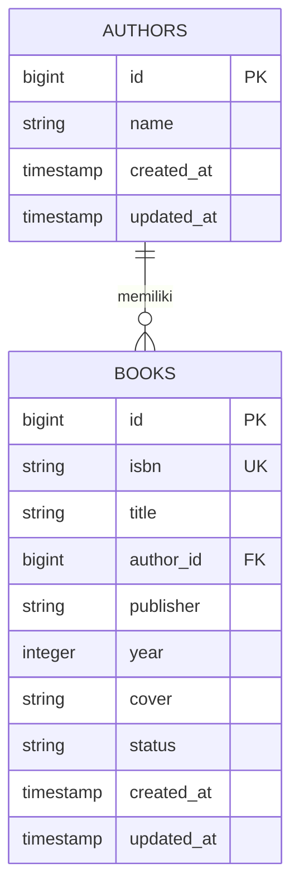

# TUGAS 3: ANALISIS DAN DOKUMENTASI

## 1. PENJELASAN ARSITEKTUR (7 POIN)

### 1.1 Diagram ERD (Entity Relationship Diagram)

Aplikasi Authbook merupakan aplikasi pengelolaan data buku yang menggunakan dua tabel utama, yaitu tabel `authors` dan tabel `books`. Kedua tabel tersebut saling berhubungan menggunakan relasi One-to-Many.

Berikut merupakan rancangan ERD aplikasi Authbook:



**Keterangan:**

1. Tabel `authors` digunakan untuk menyimpan informasi penulis buku.
2. Tabel `books` digunakan untuk menyimpan informasi buku.
3. Primary Key (PK) pada tabel authors adalah `id`.
4. Primary Key (PK) pada tabel books adalah `id`.
5. Foreign Key (FK) pada tabel books adalah `author_id`.
6. ISBN digunakan sebagai identitas unik buku.

### 1.2 Penjelasan Relasi Antar Tabel

Aplikasi Authbook menggunakan relasi One-to-Many dan Many-to-One.

**A. Relasi One-to-Many (Author ke Book)**

Relasi One-to-Many menunjukkan bahwa satu penulis dapat memiliki banyak buku.

Pada Laravel, relasi tersebut menggunakan method `hasMany()`.

Contoh implementasi pada model Author:

```php
public function books(): HasMany
{
    return $this->hasMany(Book::class);
}
```

Artinya, satu penulis dapat memiliki beberapa data buku yang tersimpan dalam tabel books.

**B. Relasi Many-to-One (Book ke Author)**

Relasi Many-to-One menunjukkan bahwa banyak buku dapat dimiliki oleh satu penulis.

Pada Laravel, relasi tersebut menggunakan method `belongsTo()`.

Contoh implementasi pada model Book:

```php
public function author(): BelongsTo
{
    return $this->belongsTo(Author::class);
}
```

Artinya, setiap buku memiliki hubungan dengan satu penulis melalui kolom `author_id`.

**C. Foreign Key**

Foreign Key digunakan untuk menghubungkan tabel books dengan tabel authors.

Kolom `author_id` pada tabel books mengambil nilai dari kolom `id` pada tabel authors.

Dengan demikian, data buku dapat diketahui siapa penulisnya dan hubungan antar tabel tetap terorganisasi.

### 1.3 Penjelasan Flow Aplikasi (Request hingga Response)

Aplikasi Authbook menggunakan framework Laravel dan Filament sebagai panel administrasi. Proses aplikasi dimulai ketika pengguna mengakses halaman melalui browser hingga sistem memberikan respons kembali.

Berikut tahapan alur kerja aplikasi:

1. **User Request**

   Pengguna membuka aplikasi melalui browser dan mengakses halaman administrasi Filament.

2. **Routing**

   Request diterima oleh Laravel dan diarahkan melalui sistem routing menuju panel administrasi yang sesuai.

3. **Authentication**

   Laravel memeriksa autentikasi pengguna untuk memastikan bahwa pengguna memiliki akses ke halaman administrasi.

4. **Filament Resource**

   Filament memproses permintaan melalui Resource yang berhubungan dengan model Author atau Book.

5. **Model dan Eloquent ORM**

   Model berkomunikasi dengan database menggunakan Eloquent ORM untuk mengambil, menambahkan, mengubah, atau menghapus data.

6. **Database**

   Database SQLite menyimpan dan mengelola data penulis serta buku.

7. **Response**

   Hasil pemrosesan dikembalikan melalui Laravel dan ditampilkan kepada pengguna dalam bentuk halaman antarmuka Filament.

**Diagram Alur Request hingga Response:**

```text
        USER
          |
          v
       BROWSER
          |
          v
    LARAVEL ROUTING
          |
          v
   AUTHENTICATION
          |
          v
   FILAMENT RESOURCE
          |
          v
    ELOQUENT ORM
          |
          v
     DATABASE
       SQLITE
          |
          v
   HASIL PEMROSESAN
          |
          v
      RESPONSE
          |
          v
     BROWSER USER
```

Melalui alur tersebut, Laravel bertanggung jawab mengatur proses aplikasi, sedangkan Filament menyediakan antarmuka administrasi untuk mengelola data.

---

## 2. PERBANDINGAN DENGAN PENDEKATAN TRADISIONAL (7 POIN)

### 2.1 Perbandingan Membuat CRUD dengan Filament dan Manual

CRUD merupakan singkatan dari Create, Read, Update, dan Delete. CRUD digunakan untuk melakukan pengelolaan data dalam aplikasi.

Dalam pengembangan aplikasi Authbook, Filament digunakan untuk membantu pembuatan panel administrasi dan pengelolaan data.

Terdapat dua pendekatan yang dapat digunakan untuk membuat CRUD, yaitu menggunakan Filament dan membuat CRUD secara manual.

**A. Menggunakan Filament**

Filament merupakan library berbasis Laravel yang membantu pengembang membuat panel administrasi dengan lebih cepat.

Dengan menggunakan Filament, pengembang dapat membuat Resource yang terhubung dengan model untuk mengelola data.

Beberapa fitur yang tersedia antara lain:
- Membuat data baru melalui form.
- Menampilkan data dalam bentuk tabel.
- Mengubah data yang sudah tersimpan.
- Menghapus data.
- Melakukan pencarian data.
- Menggunakan filter pada tabel.
- Menampilkan detail data.

Pendekatan ini mengurangi kebutuhan untuk membuat antarmuka CRUD dari awal.

**B. Menggunakan Pendekatan Manual**

Pendekatan manual merupakan metode pembuatan CRUD dengan menulis kode program sendiri menggunakan Laravel.

Pengembang perlu membuat beberapa komponen, seperti:
- Controller untuk mengatur proses CRUD.
- Route untuk menghubungkan URL dengan controller.
- Model untuk berinteraksi dengan database.
- View menggunakan Blade untuk menampilkan halaman.
- Form untuk memasukkan dan mengubah data.
- Validasi untuk memeriksa data yang dimasukkan.
- Proses penyimpanan, pengubahan, dan penghapusan data.

Pendekatan manual memberikan kebebasan lebih besar dalam menentukan tampilan dan alur kerja aplikasi.

### 2.2 Kelebihan dan Kekurangan Masing-Masing

| Aspek | Filament | Manual |
|---|---|---|
| Kecepatan | Lebih cepat dibuat | Membutuhkan waktu lebih lama |
| Penulisan kode | Lebih sedikit | Lebih banyak |
| Tampilan | Komponen sudah tersedia | Dibuat sendiri |
| Kustomisasi | Mengikuti komponen Filament | Lebih bebas |
| Pembelajaran | Perlu memahami Resource | Memahami proses CRUD secara langsung |
| Pemeliharaan | Terbantu struktur Resource | Bergantung pada struktur kode sendiri |
| Ketergantungan | Bergantung pada library | Lebih sedikit ketergantungan tambahan |

**Kelebihan Filament:**

1. Mempercepat proses pembuatan aplikasi CRUD.
2. Menyediakan komponen form dan tabel.
3. Memiliki fitur pencarian dan filter.
4. Mengurangi penulisan kode berulang.
5. Mempermudah pembuatan panel administrasi.

**Kekurangan Filament:**

1. Pengembang harus mempelajari struktur dan cara kerja Filament.
2. Kustomisasi tertentu dapat membutuhkan pemahaman lebih lanjut.
3. Bergantung pada kompatibilitas library dengan versi Laravel.
4. Kurang fleksibel apabila aplikasi membutuhkan alur antarmuka yang sangat khusus.

**Kelebihan Pendekatan Manual:**

1. Memberikan kebebasan dalam merancang tampilan aplikasi.
2. Mempermudah pengaturan alur kerja sesuai kebutuhan.
3. Membantu memahami proses CRUD secara mendalam.
4. Tidak terlalu bergantung pada library tambahan.

**Kekurangan Pendekatan Manual:**

1. Membutuhkan lebih banyak waktu pengembangan.
2. Penulisan kode lebih banyak.
3. Pengembang harus membuat tampilan dan validasi sendiri.
4. Pemeliharaan dapat menjadi lebih sulit apabila kode tidak terorganisasi.

### 2.3 Kapan Sebaiknya Menggunakan Filament dan Kapan Tidak?

**Filament sebaiknya digunakan ketika:**

1. Membuat aplikasi administrasi atau dashboard.
2. Membutuhkan pengelolaan data CRUD dengan cepat.
3. Membuat sistem pengelolaan buku, data pengguna, produk, atau kategori.
4. Membutuhkan fitur tabel, pencarian, filter, dan form.
5. Mengembangkan aplikasi berbasis Laravel yang sesuai dengan kebutuhan Filament.

**Filament tidak harus digunakan ketika:**

1. Aplikasi membutuhkan desain antarmuka yang sangat khusus.
2. Memerlukan alur interaksi yang tidak sesuai dengan komponen Filament.
3. Pengembangan lebih berfokus pada pemahaman dasar proses CRUD.
4. Penggunaan library tambahan tidak sesuai dengan kebutuhan proyek.

Berdasarkan analisis tersebut, Filament lebih cocok digunakan untuk mempercepat pengembangan panel administrasi, sedangkan pendekatan manual lebih cocok ketika pengembang membutuhkan kontrol penuh terhadap proses dan tampilan aplikasi.

---

## 3. REFLEKSI PEMBELAJARAN (6 POIN)

### 3.1 Apa yang Dipelajari dari Praktikum Ini?

Melalui praktikum ini, saya memperoleh pemahaman mengenai pengembangan aplikasi web menggunakan framework Laravel dan library Filament.

Beberapa hal yang saya pelajari adalah:

1. Memahami proses pembuatan proyek Laravel menggunakan Composer.
2. Memahami konfigurasi database SQLite.
3. Mempelajari pembuatan Model dan Migration.
4. Memahami hubungan antar tabel menggunakan relasi One-to-Many dan Many-to-One.
5. Memahami penggunaan Primary Key dan Foreign Key.
6. Mempelajari penggunaan Filament untuk membuat panel administrasi.
7. Memahami proses pengelolaan data menggunakan fitur CRUD.
8. Mempelajari penggunaan Git dan GitHub untuk menyimpan serta mengelola kode program.

Selain itu, saya juga memahami bahwa Laravel dan Filament dapat digunakan bersama untuk membangun aplikasi pengelolaan data yang lebih terstruktur dan efisien.

### 3.2 Kesulitan yang Dihadapi dan Cara Mengatasinya

Selama mengerjakan praktikum, terdapat beberapa kendala yang saya temui.

**1. Kendala Instalasi Filament**

Pada proses instalasi Filament, saya mengalami kendala terkait persyaratan versi dan security advisory dari Composer.

Cara mengatasinya adalah dengan memeriksa versi Laravel, PHP, dan dependensi yang digunakan, kemudian menyesuaikan proses instalasi dengan kompatibilitas library.

**2. Kendala pada Policy**

Saya mengalami kesalahan pada file AuthorPolicy karena deklarasi nama class tidak sesuai. Hal tersebut menyebabkan konflik dengan BookPolicy.

Cara mengatasinya adalah dengan memeriksa nama class pada setiap file Policy dan memastikan bahwa nama class sesuai dengan nama file serta tanggung jawab masing-masing.

**3. Kendala Pengelolaan Git dan GitHub**

Saya juga mengalami beberapa kendala ketika mengunggah proyek ke GitHub, terutama terkait struktur folder, remote repository, dan proses push.

Cara mengatasinya adalah dengan memeriksa direktori proyek, memastikan remote repository sudah benar, serta menggunakan perintah Git secara bertahap.

Dari kendala tersebut, saya belajar bahwa proses pengembangan aplikasi tidak hanya membutuhkan kemampuan menulis kode, tetapi juga kemampuan melakukan konfigurasi, membaca pesan kesalahan, dan mencari solusi.

### 3.3 Rencana Pengembangan Aplikasi Selanjutnya

Untuk pengembangan aplikasi Authbook selanjutnya, terdapat beberapa fitur yang dapat ditambahkan, yaitu:

1. **Pengelolaan Data yang Lebih Lengkap**

   Menambahkan informasi buku seperti kategori, deskripsi, dan tanggal penerbitan.

2. **Fitur Peminjaman Buku**

   Menambahkan fitur untuk mencatat proses peminjaman dan pengembalian buku.

3. **Pencarian dan Filter Lanjutan**

   Mengembangkan pencarian berdasarkan judul, ISBN, penulis, dan status ketersediaan buku.

4. **Pengelolaan Hak Akses Pengguna**

   Menambahkan pembagian hak akses antara administrator dan pengguna biasa.

5. **Laporan Data Buku**

   Menambahkan fitur laporan jumlah buku, jumlah penulis, serta buku yang sedang dipinjam.

6. **Pengembangan Tampilan Aplikasi**

   Mengembangkan tampilan antarmuka agar lebih menarik, mudah digunakan, dan responsif.

Dengan pengembangan tersebut, aplikasi Authbook diharapkan dapat menjadi sistem pengelolaan buku yang lebih lengkap dan dapat digunakan untuk kebutuhan administrasi perpustakaan.

---

## KESIMPULAN

Berdasarkan hasil analisis dan dokumentasi, dapat disimpulkan bahwa penggunaan Laravel dan Filament dapat membantu proses pengembangan aplikasi pengelolaan data buku.

Laravel menyediakan struktur pengembangan aplikasi, sedangkan Filament membantu pembuatan panel administrasi dan fitur CRUD secara lebih efisien.

Melalui aplikasi Authbook, saya dapat memahami hubungan antar tabel dalam database, penggunaan Eloquent ORM, proses request dan response, serta perbedaan antara pembuatan CRUD menggunakan Filament dan pendekatan manual.

Praktikum ini juga memberikan pengalaman dalam menyelesaikan permasalahan teknis selama proses pengembangan aplikasi. Dengan demikian, pengetahuan yang diperoleh dapat menjadi dasar untuk mengembangkan aplikasi web yang lebih kompleks pada praktikum berikutnya.
